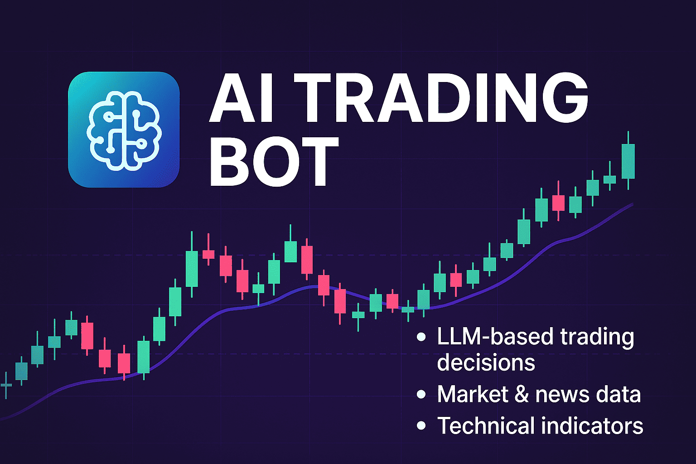

> # Note: This project is going through a major overhaul



# AI Trading Bot 🤖 + LLMs 🧠 = 💰

A trading bot that uses LLMs (Gemini, GPT, ...) to analyze market data and make trading decisions. Built because I was tired of staring at charts all day. Still a work in progress, but it's making some interesting trades!

## How This Thing Works 🔧

Unlike other trading bots where **you have to define a fixed strategy**, this one uses large language models to **reason about the data in real time** — deciding *whether* to trade and *how* to trade based on market conditions.

### 1. Market Data Pipeline

- Pulls data from Yahoo Finance API (free and works well enough)
- Gets multiple timeframes (1min -> daily) for proper analysis
- Calculates a bunch of indicators (RSI, MACD, BB, etc.) using `technicalindicators` npm package

### 2. LLM Trading Brain

- Uses LLMs as "traders" to analyze data
- Each LLM gets a detailed prompt with:
  - Price action data
  - Technical indicators
  - Market sentiment from news
  - Current positions
- They output JSON with trade decisions (entry, stop-loss, take-profit, and more)
- Auto-fallback if one model fails/times out

### 3. Trade Execution

- Connects to [MetaAPI](https://metaapi.cloud) for actual trading
- Implements position sizing based on account risk
- Handles spread checks and minimum distance for SL/TP
- Logs everything for later analysis

## Code Structure 📁

```markdown
src/
├── helpers/                       # Utility functions, caching, etc.
|
├── ticker/                        # Market data and analysis
│   └── get-full-ticker-data.js    # Main data fetcher
|
├── trade/                         # Trading logic
│   ├── TradeParams.js             # Trade parameter calculation
│   └── metaTradeApi.js            # Trading execution
└── main.js                        # Entry point
```

## Quick Start 🚀

1. Clone & install:

```bash
git clone https://github.com/kodejuice/ai-trade.git
cd ai-trade
npm install
```

2. Set up your `.env`:

You would need to setup an account with [MetaAPI](https://metaapi.cloud), and [create a MetaTrader account](https://www.youtube.com/watch?v=QlYQFNXOgXo) to get the `META_API_CLOUD_TOKEN` and `META_API_CLOUD_ACCOUNT_ID`.
Get your MetaTrader login and password from your broker.

```env
GEMINI_API_KEY=xxx
OPENAI_API_KEY=xxx
GROQ_API_KEY=xxx
META_API_CLOUD_TOKEN=xxx
META_API_CLOUD_ACCOUNT_ID=xxx
REDIS_URL=redis://localhost:6379
```

3. Let it rip:

```bash
npm start
```

## What Still Needs Work 🔨

### High Priority

- [ ] Monitor trades and update positions in real-time
- [ ] Add more sophisticated position sizing
- [ ] Implement proper backtesting framework
- [ ] Improve model prompts for better accuracy
- [ ] Web interface for monitoring trades
- [ ] Better error handling for API timeouts

### Nice to Have

- [ ] Real-time performance metrics
- [ ] More technical indicators
- [ ] Integration with more data sources
- [ ] Support for options trading
- [ ] Better documentation (lol)

### Known Issues 🐛

- Stop-loss calculations could be more dynamic

## Disclaimer ⚠️

This is experimental software. It can and will lose money. Don't blame me if it does. Use at your own risk!

## License

[MIT](LICENSE) - Do whatever you want with it, just don't sue me 🤷‍♂️
